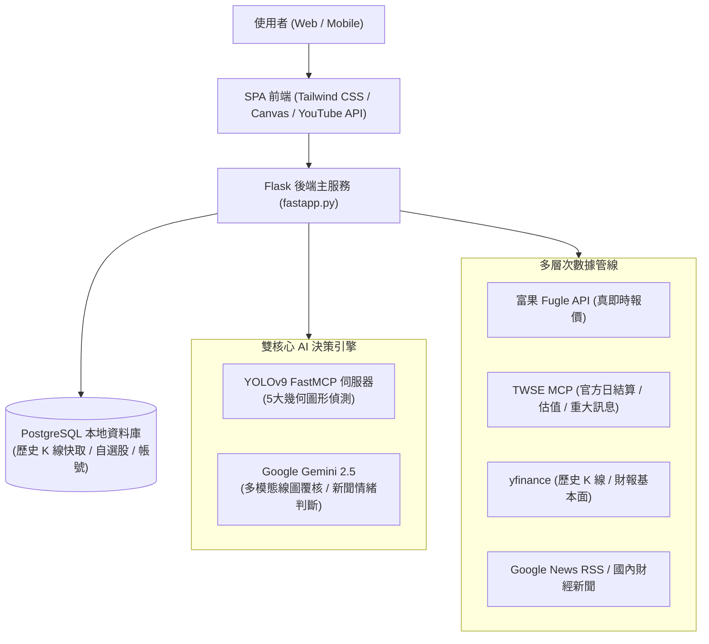

# 🎓【股Friend】畢業專題口試與評審全攻略手冊

> **專案名稱**：股Friend 智慧台股輔助分析系統  
> **所屬系所**：朝陽科技大學 資訊管理學系  
> **指導教授**：王佳文 教授  
> **文件用途**：專題審查、海報展口試、畢業專題答辯準備手冊  

---

## 📌 目錄
1. [專案核心架構與技術矩陣](#1-專案核心架構與技術矩陣)
2. [第一類：AI 模型與深度學習（YOLOv9 + LLM）](#2-第一類ai-模型與深度學習yolov9--llm)
3. [第二類：MCP 微服務架構與協議整合](#3-第二類mcp-微服務架構與協議整合)
4. [第三類：金融數據管線與即時行情](#4-第三類金融數據管線與即時行情)
5. [第四類：系統工程、資料庫快取與資安防護](#5-第四類系統工程資料庫快取與資安防護)
6. [第五類：競品差異化、商業價值與法規倫理](#6-第五類競品差異化商業價值與法規倫理)
7. [口試答辯黃金原則（STAR 法則）](#7-口試答辯黃金原則star-法則)

---

## 1. 專案核心架構與技術矩陣



---

## 2. 第一類：AI 模型與深度學習（YOLOv9 + LLM）

### Q1. 市面上已經有幾十種傳統技術指標，為什麼還要用 YOLOv9 來辨識 K 線型態？
* **老師考察目的**：檢視團隊是否「為用 AI 而用 AI」，能否釐清指標與視覺型態的本質差異。
* **標準回答指引**：
  > 「傳統指標（如 MA、RSI、KD）屬於基於數學公式的**落後型統計數據**，無法感知圖形在二維空間中的幾何特徵。但實務上投資人極度仰賴的『頭肩頂/底、雙重底(W底)、三角收斂整理』本質是**空間幾何結構**，用傳統程式寫死規則極易產生誤判。  
  > 因此我們將目標偵測（Object Detection）頂尖架構 **YOLOv9** 引入金融領域，將 K 線圖視為視覺圖像進行卷積特徵學習，能自動框選出幾何型態的精確位置，將技術分析從抽象公式升級為直觀視覺輔助。」

### Q2. 訓練 YOLOv9 的數據集是如何建立的？準確率與信心度門檻是多少？
* **老師考察目的**：確認模型是否為自行標註訓練，而非拿開源現成權重交差。
* **標準回答指引**：
  > 「我們團隊透過 Python 腳本自台股歷史資料批量渲染出數千張真實 K 線圖，並人工進行精準 Bounding Box 標註，涵蓋台股 5 大經典型態。  
  > 為了避免雜訊，我們在推論端設定了嚴格的 **信心度門檻 $\ge 60\%$**，並透過非極大值抑制（NMS, Non-Maximum Suppression）演算法去除重複辨識邊界框，確保推論輸出穩定可靠。」

### Q3. 如果 YOLO 辨識出是 W 底，但 Gemini LLM 覆核時認為不是，系統聽誰的？
* **老師考察目的**：雙模型架構（Dual-AI）的衝突解決機制與防呆設計。
* **標準回答指引**：
  > 「我們採用**『電腦視覺精確定位 + 多模態語意覆核』的雙重檢驗架構**：  
  > 1. 第一層由 YOLO 負責在圖像像素上繪製出疑似型態的邊界框與座標。  
  > 2. 第二層將原圖與邊界框一同傳給 Gemini 2.5 進行上下文趨勢覆核。  
  > 若 Gemini 判斷該圖表目前處於平緩盤整、或幾何特徵不成熟，系統會採取**保守原則**，自動降級歸類為『無明顯型態』，避免給予使用者過度樂觀的誤導訊號（即極力壓低偽陽性 False Positive）。」

### Q4. Watchbot 是如何利用 LLM 判斷新聞「利多/利空」的？如何防止 AI 幻覺？
* **老師考察目的**：提示詞工程（Prompt Engineering）與結構化輸出的嚴謹度。
* **標準回答指引**：
  > 「我們在後端設計了 **Strict JSON Schema 的 Prompt Constraints**：  
  > 1. 嚴格限制模型輸出標準 JSON，欄位限定 `news_sentiment`（僅能是『利多』或『利空』）與 `reasons`（條列 3 點客觀依據）。  
  > 2. 後端設有防呆驗證器（Validator），若回傳格式不符或解析失敗，會觸發自動重試或降級策略，完全不讓 AI 自由發揮非結構化文字，徹底根絕幻覺問題。」

---

## 3. 第二類：MCP 微服務架構與協議整合

### Q5. 什麼是 MCP (Model Context Protocol)？為什麼不直接在 Python 裡寫一般函式？
* **老師考察目的**：考察學生對現代 AI 系統工程架構（微服務與解耦）的理解深度。
* **標準回答指引**：
  > 「MCP 是 Anthropic 主導的開放協議，專為解決 AI 應用與外部工具（Tools/APIs）之間的整合標準。在架構層面有兩大不可取代的優勢：  
  > 1. **環境隔離與微服務解耦**：YOLOv9 依賴 PyTorch、CUDA 與 Python 3.10，若將其與 Web 伺服器強行混在同一程序，容易因依賴衝突或推論阻塞導致全站崩潰。透過 FastMCP 封裝成獨立 Server，實現行程間解耦。  
  > 2. **隨插即用的 Tool-Calling**：符合標準協議後，未來無論接入何種 LLM Agent，都能以通用的工具協議動態呼叫我們的模型，極具擴充性。」

### Q6. 系統整合了哪些 MCP？如果遠端服務中斷了怎麼辦？
* **老師考察目的**：系統的容錯設計（Fault Tolerance）與高可用性思考。
* **標準回答指引**：
  > 「我們實作了 `MultiMCPClient` 統一管理器，調度 4 大服務：**證交所 TWSE MCP**、**TA-Lib 指標 MCP**、**yfinance MCP** 以及自研的 **YOLOv9 MCP**。  
  > 針對可用性，我們設計了自動容錯機制（Fallback）：  
  > * 證交所 MCP：雲端端點異常時自動無縫轉向本地備援端點（`127.0.0.1:8000`）。  
  > * YOLOv9 MCP：若 Stdio 行程發生阻礙，系統會自動啟動本地 Python 直連通道直接推論，確保前端用戶體驗不中斷。」

---

## 4. 第三類：金融數據管線與即時行情

### Q7. 盤中即時報價的延遲度如何？你們是如何抓取報價的？
* **老師考察目的**：金融系統對「時效性」與 API 限流機制的工程實踐。
* **標準回答指引**：
  > 「我們設計了三層級數據管線：  
  > 1. **首選：Fugle 富果 API**（官方合法 WebSocket/REST 授權，盤中真即時零延遲）。  
  > 2. **二線備援：證交所 TWSE MIS 官方系統**（盤中批次獲取多股即時快照，毫秒級響應）。  
  > 3. **三線保險：yfinance `fast_info`**（提供盤後與備份行情）。  
  > 透過這套階梯式管線，確保不論是在開盤、盤後或週末，前端都能穩定拿到正確數據。」

### Q8. 老師先前提到新聞抓取是「傳統方式」，你們現在是如何實作的？未來如何改進？
* **老師考察目的**：學生面對審查意見時的自省能力與架構演進思考。
* **標準回答指引**：
  > 「目前專案的新聞抓取採用 **Google News RSS 搭配 BeautifulSoup 與 JSON-LD 結構化資料解析**。  
  > * **目前的考量**：在專案 MVP 開發階段，此法完全免費且涵蓋台股全部個股，性價比最高。  
  > * **認知到傳統方式的限制**：網頁爬蟲容易受到目標網站改版影響，且依賴輪詢（Polling）。  
  > * **未來升級架構**：未來產品化將升級對接**現代逆向 JSON API**（如鉅亨網、Yahoo 股市內部 API）或專業金融新聞串流，直接接收乾淨 JSON，徹底擺脫 HTML 標籤依賴。」

---

## 5. 第四類：系統工程、資料庫快取與資安防護

### Q9. 前端載入一檔股票需調用 K 線、基本面、新聞與指標，網頁會不會卡頓？
* **老師考察目的**：非同步並行處理（Concurrency）與快取機制。
* **標準回答指引**：
  > 「我們在後端全面使用 Python `asyncio.gather` 與 `ThreadPoolExecutor`，同時並行向各個數據源發送請求，將聚合耗時壓低在 1 秒內。  
  > 此外，台股歷史 K 線與技術特徵已預先快取於本地 **PostgreSQL 資料庫**，前端查詢歷史時直接讀取本地索引，查詢時間小於 0.05 秒。」

### Q10. 使用者密碼在資料庫中如何儲存？有做防護嗎？
* **老師考察目的**：基礎資訊安全常識（資管系必考題目）。
* **標準回答指引**：
  > 「系統絕對不儲存明文密碼。我們採用工業級的 **加鹽雜湊（Salted Hashing）演算法**（Werkzeug 安全雜湊），即使資料庫遭到外洩，攻擊者也無法逆向還原密碼；使用者會話由後端 Session 安全密鑰（Secret Key）簽名管理。」

---

## 6. 第五類：競品差異化、商業價值與法規倫理

### Q11. 市面上已有三竹股市、Yahoo 股市、TradingView，本系統的核心競爭優勢是什麼？
* **老師考察目的**：目標市場（Target Audience）與痛點定位。
* **標準回答指引**：
  > 「市售主流軟體多是為『具備專業背景的資深投資人』設計，介面充斥著密密麻麻的數字與複雜指標，對**新手投資人**門檻極高。  
  > 『股Friend』專注於降低學習曲線：  
  > 1. **AI 自動框選型態**：新手不用自己畫支撐壓力線，由 YOLO 自動圈選。  
  > 2. **白話導讀報告**：Gemini 將冷硬的財務與技術指標翻譯成白話文解讀。  
  > 3. **一鍵消息面定性**：自動總結當日新聞是利多或利空，讓新手能迅速建立投資全貌。」

### Q12. 系統給出買賣訊號，是否會觸犯金管會《證券投資信託及顧問法》（非法投顧）？
* **老師考察目的**：金融科技（FinTech）專案的法律合規性。
* **標準回答指引**：
  > 「這在專案初期我們就已進行嚴格的合規隔離：  
  > 1. **全站免責聲明**：首頁、登入頁與對話框均標示系統為『學術研究與客觀決策輔助工具』。  
  > 2. **禁止具體目標價預測**：系統僅客觀呈現歷史幾何型態與數據特徵，**絕不給予具體進出場價位保證、亦不涉及投資顧問跟單業務**，完全符合法規規範。」

---

## 7. 口試答辯黃金原則（STAR 法則）

口試遇到任何尖銳質疑時，請默念三步應對公式：

```
[步驟 1: 大方承認並肯定問題] 
👉「老師您看得很細，這確實是系統在初期版本中需要權衡的地方...」

[步驟 2: 說明當下的工程考量] 
👉「我們當時在有限時間與資源下，優先以打造端到端 MVP 驗證為主...」

[步驟 3: 亮出未來的演進藍圖] 
👉「針對這點，我們在後續架構規劃中已經設計好第二階段的升級方案（如改接商業 API / 建立 Redis 快取）...」
```
保持微笑、條理清晰，評審老師一定會給予高度評價！
